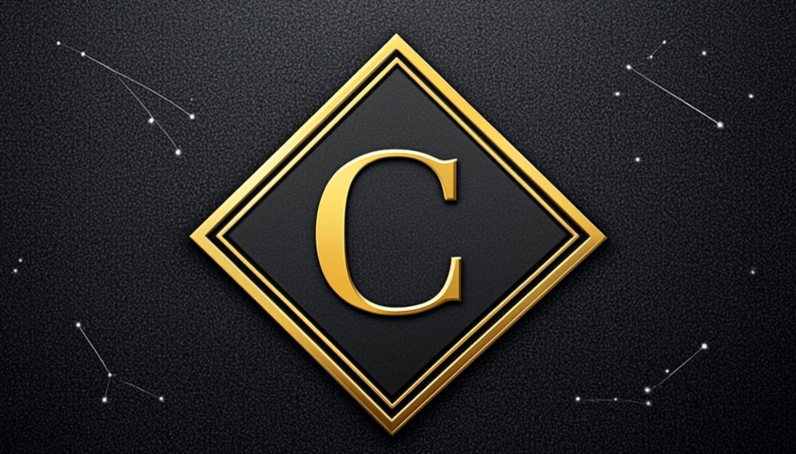
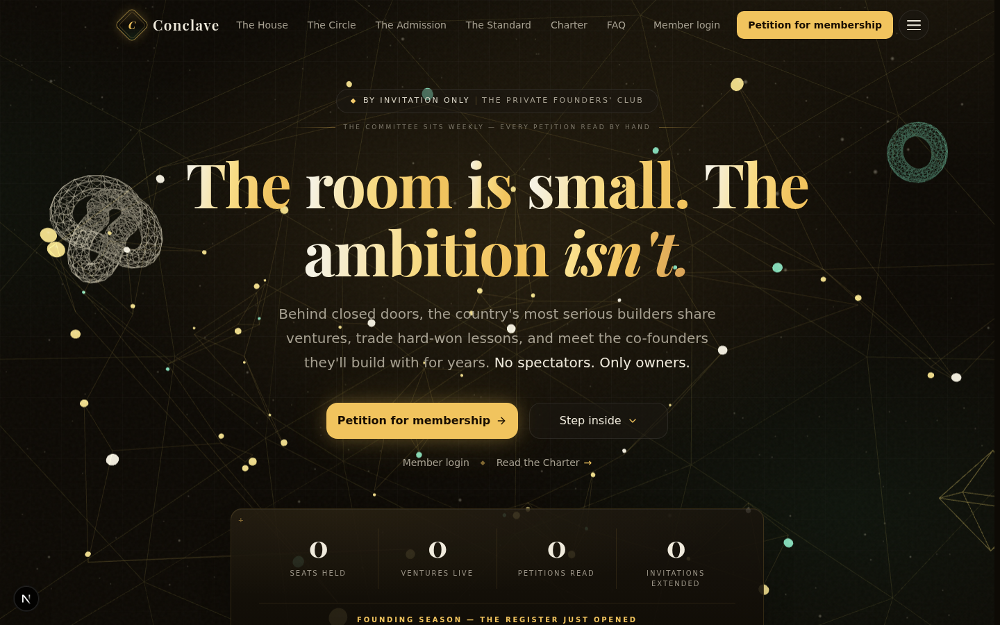
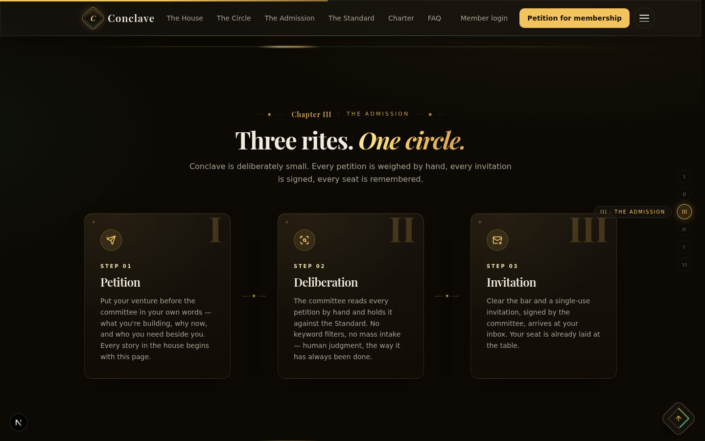
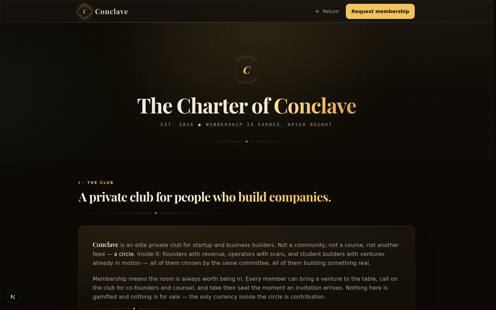
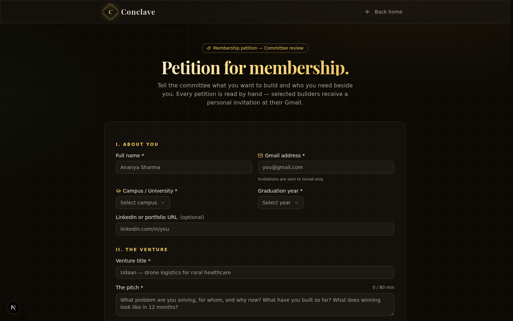
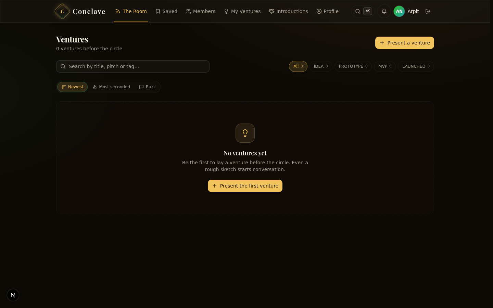
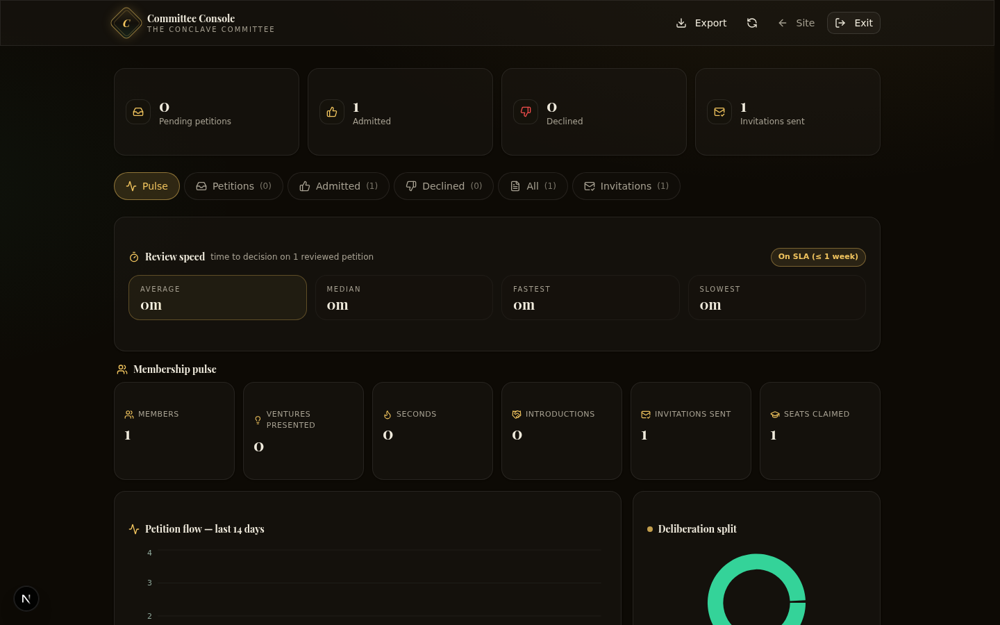

<div align="center">



# ◆ C O N C L A V E

### The Private Founders' Club

**"The room is small. The ambition isn't."**

An invite-only network where the most serious builders share ventures,
trade hard-won lessons, and meet the co-founders they build with for years.
No spectators. Only owners.

<br>

&nbsp;
&nbsp;
&nbsp;
&nbsp;
&nbsp;
&nbsp;


<br>

`Est. 2025  ◆  Membership is earned, never bought.`

</div>

---

## ✦ The Club

Conclave is a private club, not a community board. Founders **petition** for membership, the committee **deliberates** every petition by hand, and **invitations** are extended one seat at a time — each one a single-use key that works exactly once, for one Gmail, one founder.

There is no public feed, no open signup, and no way to buy a way in. The register just opened — founding season is on.

---

## ✦ The Tour

<table>
  <tr>
    <td width="50%" align="center"><br><sub><b>The House</b> — engraved serif hero over a living constellation</sub></td>
    <td width="50%" align="center"><br><sub><b>The Admission</b> — petition → deliberation → invitation → initiation</sub></td>
  </tr>
  <tr>
    <td width="50%" align="center"><br><sub><b>The Charter</b> — seven sections of house law, sealed in gold</sub></td>
    <td width="50%" align="center"><br><sub><b>The Petition</b> — the only door in: tell the committee the real story</sub></td>
  </tr>
  <tr>
    <td width="50%" align="center"><br><sub><b>The Room</b> — the members' club: ventures, seconded and ranked</sub></td>
    <td width="50%" align="center"><br><sub><b>The Committee Console</b> — pulse, docket and deliberations</sub></td>
  </tr>
</table>

---

## ✦ Read in Six Chapters

The landing page reads as one document in six chapters, with a scroll-spy rail as its table of contents:

| § | Chapter | It answers |
|---|---------|------------|
| **I** | The House | *What is this place?* |
| **II** | The Circle | *Who sits here — and why so small?* |
| **III** | The Admission | *How does one get in?* |
| **IV** | The Standard | *What does the committee look for?* |
| **V** | The Table | *What happens inside — founding season* |
| **VI** | Questions | *Everything else, asked and answered* |

---

## ✦ Inside the Club

**For members** — *The Room* (venture feed with IDEA / PROTOTYPE / MVP / LAUNCHED filters, "second" support and buzz ranking) · *Saved* collections · *Members* directory · *Introductions* · a **⌘K command palette** · quiet notifications · founder profiles.

**For the committee** — a password-sealed console with a live petition docket, admit / decline with deliberation notes, single-use Gmail invitations, keyboard shortcuts, **Pulse** analytics (review speed vs. SLA, membership pulse, petition flow, deliberation split) and CSV export of the rolls.

**Everywhere** — honest empty states (founding season is real), rate-limited petitions, HMAC-signed sessions, and a design system measured in obsidian and champagne gold.

---

## ✦ Built With

| Layer | Choice |
|---|---|
| Framework | **Next.js 16** — App Router, Turbopack |
| UI | **React 19** · **shadcn/ui** (New York) · **Lucide** icons |
| Styling | **Tailwind CSS 4** · custom obsidian/gold token system |
| Motion | **Framer Motion** · **three.js** constellation hero |
| Database | **Prisma 6** + **SQLite** |
| Auth | Custom **HMAC-signed tokens** · email OTP codes |
| State | **Zustand** · **TanStack Query** |
| Validation | **Zod** |
| Runtime | **Bun** |

---

## ✦ Begin

```bash
git clone https://github.com/arpitnayan123-bot/Conclave.git
cd Conclave
bun install

# configure the environment
cp .env.example .env
#   → set AUTH_SECRET (any long random string)
#   → set ADMIN_PASSWORD (your committee password)

bun run db:push      # create the SQLite database
bun run dev          # the house opens at http://localhost:3000
```

The club starts **empty by design** — that's founding season. Take Seat No. 1 yourself:

1. Petition for membership at `#/submit`
2. Unlock the committee console at `#/admin`
3. Admit the petition, extend the invitation
4. Open the invitation link, claim your seat — the room is yours

---

## ✦ The Environment

| Variable | Required | Purpose |
|---|---|---|
| `AUTH_SECRET` | **yes** — the app refuses to sign tokens without it | HMAC signing for member & admin sessions |
| `ADMIN_PASSWORD` | **yes** — for `#/admin` | The committee console password |
| `DATABASE_URL` | yes | SQLite file location (`file:./db/custom.db`) |

---

## ✦ The Routes

| Route | Room |
|---|---|
| `#/` | The house — six chapters |
| `#/submit` | Petition for membership |
| `#/club` | The Charter of Conclave |
| `#/platform` | The members' club *(seat required)* |
| `#/admin` | The Committee Console *(password)* |
| `#/join?token=…` | Claim your seat *(single-use invitation)* |

---

## ✦ The API

A compact, typed API surface under `/api`:

- **Petitions** — submit, list (admin), review, bulk actions
- **Members** — login, signup-by-invitation, email OTP codes, profiles, spotlight
- **Ventures** — present, comment, second interest, bookmark, link preview
- **Collections** — private saved lists per member
- **Introductions** — member-to-member connection requests
- **Invitations** — single-use token minting & validation
- **Notifications · Pulse · Stats** — the quiet infrastructure of the club

---

## ✦ The Craft

| Token | Value |
|---|---|
| Obsidian | `oklch(0.145 0.012 80)` — the room's walls |
| Champagne gold | `oklch(0.84 0.13 85)` — the only accent |
| Ivory | `oklch(0.94 0.02 92)` — the printed word |

Playfair Display carries the engraved headlines; a quiet mono carries the micro-type.
Details are the design: a scroll-spy chapter rail, per-word hero stagger, reveal-on-scroll
sections, `⌘K` everywhere, zero horizontal overflow at 390 / 820 / 1440 — and not a single
placeholder where truth should be.

---

## ✦ The Charter

> *Membership is earned, never bought.*

Read the full house law at `#/club` — seven sections, sealed in gold.

---

<div align="center">

**Crafted by [Arpit Nayan](https://github.com/arpitnayan123-bot)**

`◆  Est. 2025 — the register just opened.  ◆`

</div>
